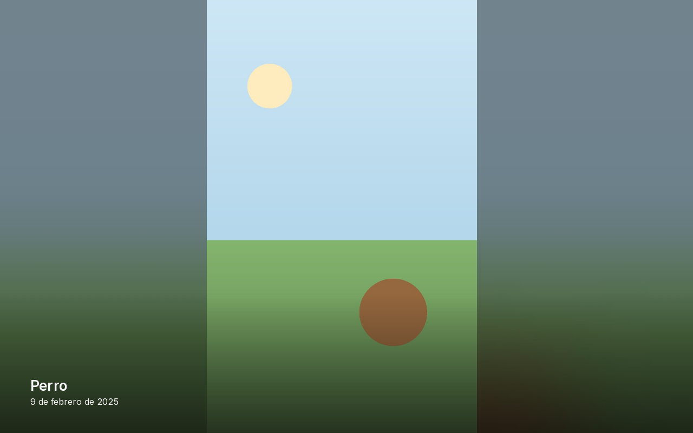
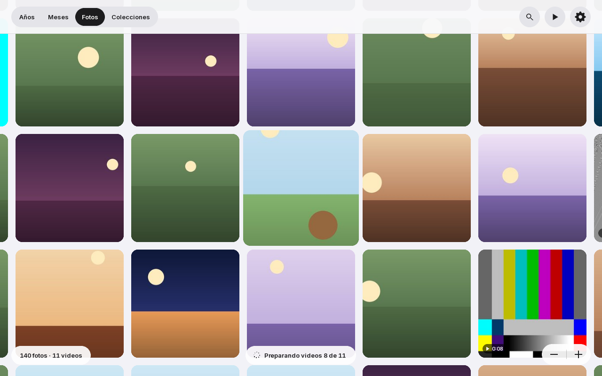
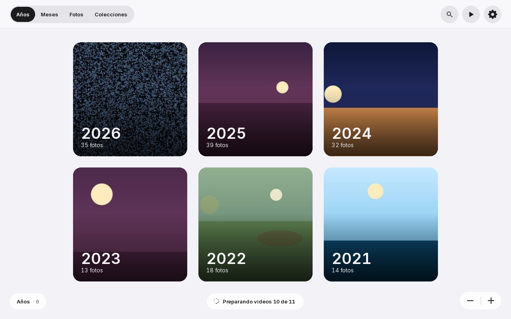
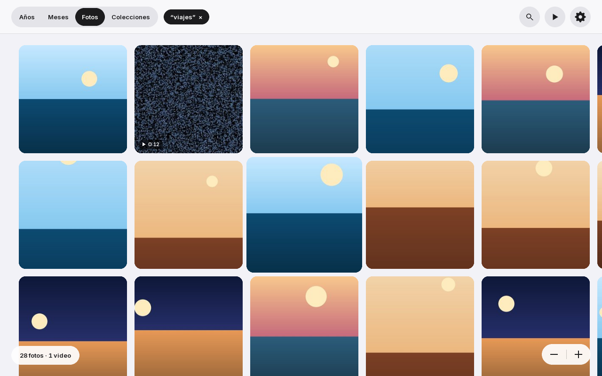
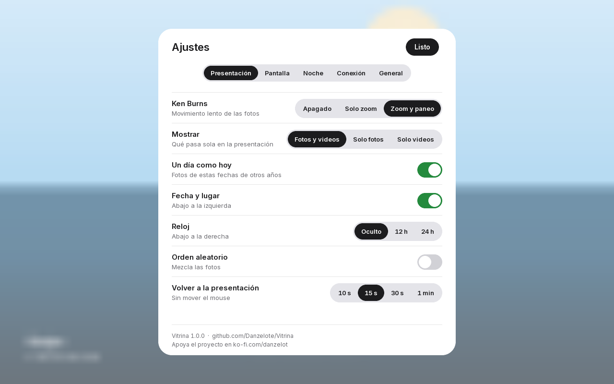
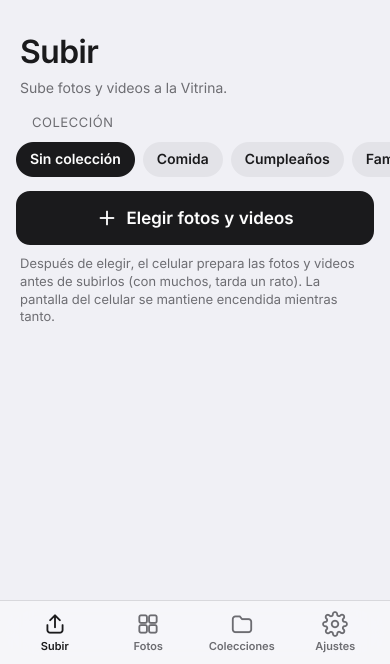

# Vitrina

**Convierte una Mac vieja en un portarretratos digital para fotos y videos.**
*Turn an old Mac into a digital photo and video frame.*

Vitrina se instala en una Mac Intel vieja (2006–2015) y la convierte en un portarretratos: arranca directo a tus fotos y videos, sin escritorio ni nada más. La idea es que se sienta como algo que Apple pudo haber hecho: limpio, simple y con animaciones cuidadas.

**[Descargar la versión más nueva](https://github.com/Danzelote/Vitrina/releases/latest)** · [Cómo instalar](docs/usb.md) · [Atajos de teclado](docs/atajos.md)

## Qué hace

- **Presentación a pantalla completa** de fotos y videos, con transiciones suaves, efecto Ken Burns, reloj, fecha y lugar, y "un día como hoy".
- **Al mover el mouse**, la foto se encoge hasta su lugar en una cuadrícula que puedes explorar y acercar con dos dedos. Al alejarte, las fotos se agrupan por meses y por años.
- **Colecciones y búsqueda**: elige una colección o escribe *videos*, *2019*, *diciembre* o un lugar, y la cuadrícula se reacomoda solo con esas.
- **Las fotos llegan desde tu celular**: escaneas un código QR en la pantalla y subes fotos por tu WiFi. Sin cuentas, sin nube y sin app que instalar. Desde el celular también puedes borrar, ordenar en colecciones y cambiar ajustes.
- **También desde una memoria USB**: al conectarla, ofrece importar sus fotos.
- **Funciona sin internet**: las fotos viven en la propia Mac. Las duplicadas se detectan solas.
- **Cuida la pantalla**: brillo automático con el sensor de luz de la Mac, modo noche con horario, y reposo al cerrar la tapa.
- **Se actualiza sola** desde este repositorio, sin tocar tus fotos ni tus ajustes.
- **Para casas con gatos**: Control + L (3 segundos) bloquea el teclado y el trackpad.
- En **español e inglés**.

| Cuadrícula | Por años |
|---|---|
|  |  |
| **Búsqueda** | **Ajustes** |
|  |  |

## Cómo se instala

1. Descarga la imagen `vitrina-….iso` desde [Releases](https://github.com/Danzelote/Vitrina/releases/latest).
2. Grábala en una memoria USB de 1 GB o más con [balenaEtcher](https://etcher.balena.io).
3. Enciende la Mac con la tecla **⌥ Option** presionada y elige **EFI Boot**.
4. Vitrina abre desde la USB, **sin tocar el disco**: conecta el WiFi y prueba que todo funcione.
5. Cuando estés listo: **Ajustes → General → Instalar en esta Mac**. Borra macOS, pero conserva la recuperación (⌘R) por si algún día quieres volver.
6. Quita la USB, reinicia y escanea el código QR con tu celular para subir fotos.

Los pasos completos, con lo que pasa en cada uno, están en [docs/usb.md](docs/usb.md).

## Macs compatibles

| Nivel | Macs |
|---|---|
| Probada | MacBook 13" blanca de mediados de 2009 (Core 2 Duo, 2 GB) |
| Deberían funcionar | Macs Intel con Core 2 Duo o más nuevas (finales de 2006 a ~2015), 2 GB de RAM o más |
| Mínimo | Core 2 Duo con 1 GB (más lento) |
| Más adelante | Core Duo de 2006 (32 bits) |
| No | PowerPC |

¿La probaste en otro modelo? Cuéntalo en un [issue](https://github.com/Danzelote/Vitrina/issues) y se agrega a [docs/compatibilidad.md](docs/compatibilidad.md).

## Falta probar

- **Importar desde una memoria USB**: funciona en las pruebas, pero aún no en una Mac real.
- Modelos distintos a la MacBook 2009. Las MacBook Pro, iMac y Mac mini de la misma época deberían funcionar, pero nadie lo ha confirmado.

Detalles conocidos: entre el logo de arranque y las fotos hay un instante en negro, y al apagar pueden verse unas líneas de texto. Son del sistema base y se corregirán en una próxima imagen de la USB.

## Documentación

- [docs/usb.md](docs/usb.md): grabar la USB, probar, instalar y actualizar.
- [docs/atajos.md](docs/atajos.md): atajos de teclado (en la Vitrina, tecla H).
- [docs/compatibilidad.md](docs/compatibilidad.md): modelos probados y hallazgos.
- [docs/desarrollo.md](docs/desarrollo.md): correr la app en tu computadora para desarrollar.
- [docs/proyecto.md](docs/proyecto.md): diseño, decisiones y arquitectura.

## Apoya el proyecto

Vitrina es gratis y de código abierto. Si te sirvió, o simplemente te gusta la idea de darle una segunda vida a las Macs viejas, puedes apoyar su desarrollo con una donación:

También ayuda mucho probarla en tu Mac y contar cómo te fue.

## Licencia

[GPL-3.0](LICENSE). Puedes usar, modificar y compartir Vitrina; las versiones modificadas que distribuyas deben seguir siendo libres.
